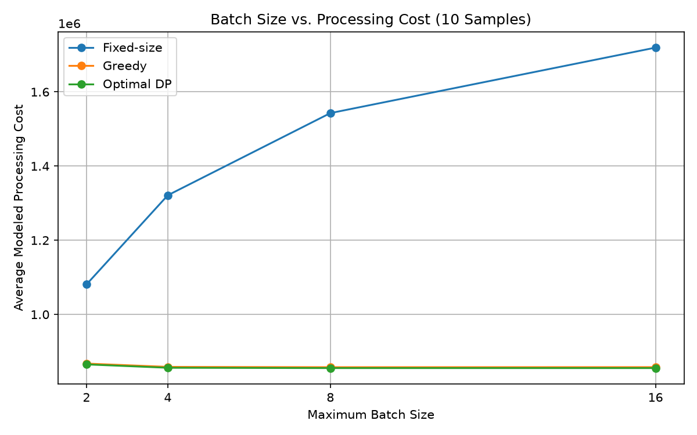
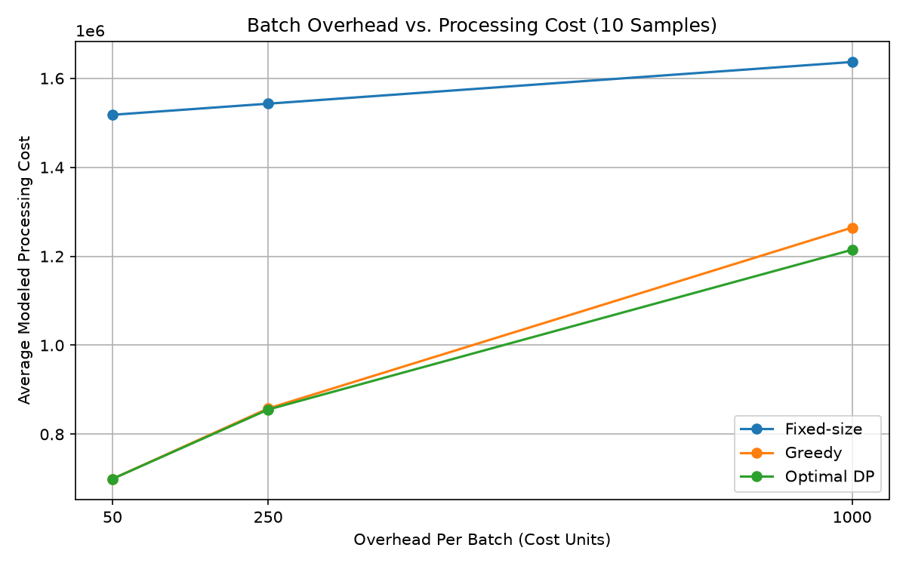
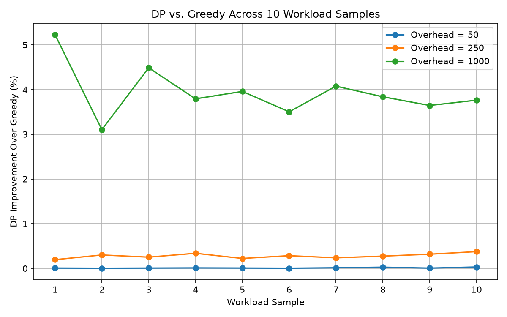
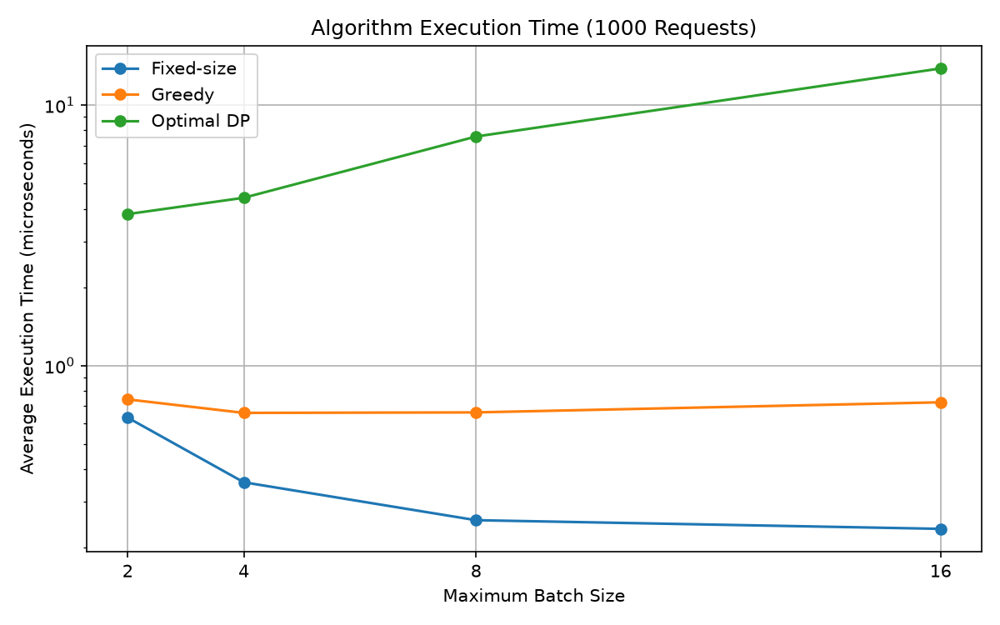

# LLM Batching Optimization

## Overview

For this project, I wanted to look into how dynamic programming could optimize request batching in LLM inference systems. When requests with different token lengths are processed together, shorter requests might need to be padded to match the longest one, which can waste computation.

I implemented three batching algorithms in C++ and compared their processing costs using real request data from the [BurstGPT dataset](https://github.com/HPMLL/BurstGPT). I also tested how changing the maximum batch size and processing overhead affects their performance.

## Algorithms

I implemented three approaches:

1. **Fixed-size batching:** Groups consecutive requests into batches of a fixed size, irrespective of their token lengths.
2. **Greedy batching:** Decides whether to add a request to the current batch or start a new one, based on whichever option is cheaper.
3. **Dynamic programming:** Finds the optimal way to split requests into batches by considering all valid batch boundaries and reusing previously calculated minimum costs.

For all three, I used the same simplified cost model:

`Batch Cost = Overhead + Batch Size * Max Token Length`

The overhead represents the fixed cost of processing a batch, while the second term in this accounts for processing padded tokens. I also kept requests in their original order and limited how many could be in a singular batch.

For the dynamic programming, I used `dp[i]` to store the minimum cost of processing the first `i` requests. For each position, I tried all possible valid sizes for the last batch and picked the lowest total cost. I also kept track of the chosen boundaries so I could reconstruct the optimal batches afterward.

### Time and Space Complexity


<table align="center">
  <tr>
    <th>Algorithm</th>
    <th>Time</th>
    <th>Space</th>
  </tr>
  <tr>
    <td>Fixed-size</td>
    <td>O(n)</td>
    <td>O(1)</td>
  </tr>
  <tr>
    <td>Greedy</td>
    <td>O(n)</td>
    <td>O(1)</td>
  </tr>
  <tr>
    <td>Dynamic Programming</td>
    <td>O(nB)</td>
    <td>O(n)</td>
  </tr>
</table>

Here, `n` is the number of requests and `B` is the maximum batch size. Dynamic programming takes longer because it considers up to B possible batch sizes for each request.

## Dataset and Testing

I used the [BurstGPT dataset](https://github.com/HPMLL/BurstGPT), which contains real ChatGPT and GPT-4 workload traces, including request timestamps and token counts.

I initially tested using 1,000 requests, then expanded the benchmarks to 10,000 valid ChatGPT requests. I divided these into 10 consecutive samples of 1,000 requests each to see whether the results stayed consistent across different parts of the workload.

I compared the algorithms using:

- Maximum batch sizes of 2, 4, 8, and 16
- Batch overheads of 50, 250, and 1,000
- 10 workload samples, for a total of 120 experiments

I also wrote automated C++ tests covering empty inputs, single requests, known examples, and different batch sizes. For small inputs, I compared dynamic programming against brute force to verify that it was actually finding the optimal solution.

## Results

### Processing Cost

For a maximum batch size of 8, these were the average costs across the 10 samples:


<table align="center">
  <tr>
    <th>Overhead</th>
    <th>Fixed-size</th>
    <th>Greedy</th>
    <th>Optimal DP</th>
  </tr>
  <tr>
    <td>50</td>
    <td>1,517,861</td>
    <td>699,556</td>
    <td>699,472</td>
  </tr>
  <tr>
    <td>250</td>
    <td>1,542,861</td>
    <td>857,806</td>
    <td>855,414</td>
  </tr>
  <tr>
    <td>1,000</td>
    <td>1,636,611</td>
    <td>1,264,310</td>
    <td>1,214,502</td>
  </tr>
</table>

<p align="center">
  
</p>

<p align="center">
  
</p>

The fixed-size approach consistently performed the worst. This makes sense because it doesn't consider token lengths when grouping requests, so batches with very different request sizes end up wasting a lot of computation on padding.

One interesting thing was that increasing the maximum batch size actually made fixed-size batching worse. Larger batches meant even more padding, while greedy and DP could choose to keep batches smaller when needed.

### DP vs. Greedy

<p align="center">
  
</p>

What surprised me was how close greedy got to the optimal DP solution, especially when the overhead was low.

At a maximum batch size of 8, DP's average improvement over greedy across the 10 samples was:

- **Overhead 50:** 0.012%
- **Overhead 250:** 0.28%
- **Overhead 1,000:** 3.94%

DP had a lower cost in all 120 experiments, but its advantage became much more noticeable as the overhead increased.

This makes sense because greedy only considers the immediate cost of adding a request, while DP can account for how that decision affects the remaining batches. When starting a new batch becomes more expensive, making those decisions optimally matters more.

### Execution Time

I also measured how long each algorithm took to run in C++, averaging repeated executions.

<p align="center">
  
</p>

As expected, fixed-size and greedy batching were much faster than DP. At a batch size of 8 and overhead of 250, greedy took around 0.66 microseconds, while DP took around 7.58 microseconds on average.

DP gets slower as the maximum batch size increases because it has more possible batch boundaries to evaluate. Greedy stays roughly constant since it only processes each request once.

The tradeoff is that DP spends more CPU time finding a better batching arrangement, which can reduce the modeled cost of actually processing the requests.

## Limitations and Takeaways

One limitation is that this is a simplified model of LLM batching. I'm calculating an estimated processing cost rather than measuring actual GPU inference time. The model assumes padding-based processing and doesn't account for things like GPU memory constraints, request arrival times, or continuous batching.

DP also assumes the requests are known ahead of time, so this definitely can't be considered a real-time inference scheduler.

My main takeaway is that **DP guarantees the lowest cost under this model, but the improvement isn't always large enough to justify the extra computation**. For workloads where starting a batch is relatively cheap, greedy performs almost as well. However, when the overhead is higher, DP becomes more useful.

It was interesting to see that a relatively simple greedy algorithm could get so close to the optimal solution, and that the value of DP depended heavily on the workload and cost assumptions.

## Running the Project

The repository includes the C++ algorithms, automated tests, data preparation script, benchmarking code, results, and graphs.

From the repository root, using a C++17 compiler:

**Run the algorithms:**

```powershell
g++ -std=c++17 src/main.cpp -o main.exe
.\main.exe
```

**Run the tests:**

```powershell
g++ -std=c++17 tests/test_batching.cpp -o tests.exe
.\tests.exe
```

**Run the benchmarks:**

```powershell
g++ -std=c++17 -O2 src/benchmark.cpp -o benchmark.exe
.\benchmark.exe
```

**Generate the graphs:**

```powershell
py -m pip install matplotlib
py scripts/plot_results.py
```

The extracted request data is included in the repository. To regenerate the 10,000-request input file, download `BurstGPT_1.csv` into the `data/` folder and run:

```powershell
py scripts/prep_data.py
```

## Reference

Wang et al., *BurstGPT: A Real-World Workload Dataset to Optimize LLM Serving Systems*, KDD 2025.

https://github.com/HPMLL/BurstGPT
